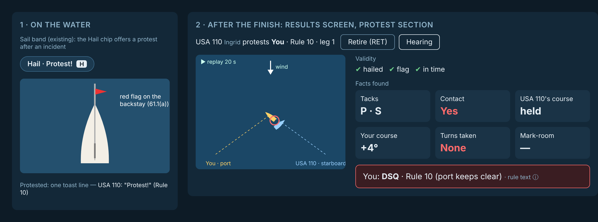

# Protests and hearings (RRS Part 5): design for the owner

Rules session, 13 Nov 2026. Status: proposal. Nothing is built.

## What changes, in one line

Today the sim **umpires**: a foul puts the turns on the fouler, and she can't finish until they're done (world.ts: the
finish doesn't count while `penalty > 0`). Real fleet racing **polices itself**. The fouler takes a penalty *if she
believes she fouled* (rule 44.1). If she doesn't, the other boat hails "Protest" and flies the red flag (rule 61.1). A
hearing after the race finds the facts and decides (rules 63–64).

## Decision for the owner (1)

Which is the default for a race?

| | **Umpired** (today) | **Protests** (new) |
|---|---|---|
| A foul | the engine calls it; the turns are owed | the engine still knows, and still tells you (one line); the turns are your choice |
| Not taking them | you can't finish | the other boat may protest; a hearing after the race; DSQ if upheld |
| Teaches | what the rules say | that plus the real game: when to take your turns, when to protest, how a hearing goes |

Recommendation: **Protests for races, Umpired for practice and the rounding drill.** One setting in the race setup
menu: "On-the-water judging". No new button on the game surface.

## What the player sees and does (existing elements only)

1. **Hailing.** The sail band's Hail chip (`.sb-hail`, key H), which today offers "Room to tack!" and "Starboard!", offers
   **"Protest!"**. It shows for 10 s after an incident with another boat that involves you. One press does two things:
   it hails, and the red flag goes up on the backstay.
   - Rule 61.1(a): a boat over 6 m hull length must fly it "at the first reasonable opportunity". A Folkboat is 7.64 m.
   - The flag is drawn on the boat. It needs a visual-checker pass from both sides on both tacks.
2. **Being protested.** The AI's hail arrives as the existing toast, one short line: `USA 110: "Protest!" (Rule 10)`.
   You see her red flag.
3. **Taking your turns.** This is unchanged: steer them, as today. Turns done count as the penalty (44.1).
4. **After the finish.** If there's a protest, the results screen gets one more row of tiles, a **Protest** section.
   For each protest it shows:
   - who protests whom, with sail numbers;
   - the rule alleged;
   - two choices: **Retire** (RET, rule 44.1(b)) or **Hearing**.
   Nothing changes on the water.

## The hearing (a panel in the results screen, pictures first)

- **The incident.** The race replay already records the race (`replay/raceReplay`). The hearing plays the 20 s around
  the incident in the existing ReplayView canvas: the two boats, the wind arrow, the mark and the zone if there was one.
- **Facts found** are tiles, not prose:
  - the tack, and overlapped or not;
  - who was inside;
  - each boat's course change in the last 3 s;
  - contact or a swerve;
  - whether the penalty was taken.

  They come straight from the incident's `PairRecord` copy and the pose rings.
- **Validity**, as three ticks:
  - hailed at the first reasonable opportunity;
  - flag flown;
  - protest delivered in time (61.1, 61.3).

  An invalid protest is closed, and the tile says why.
- **Decision.** One line, with the rule and a link to the rule's text (the existing explain popover):
  - DSQ;
  - dismissed;
  - exonerated under 43.1;
  - penalty already taken (no further penalty, rule 64.2).
- **The scores update** in the results table above it.

## Decision for the owner (2)

How does the committee find the facts?
- **(a) Exact.** The committee knows what the sim knows, so the right answer always comes out. This is simple, and it
  teaches the rule. *Recommended to start.*
- **(b) From testimony.** Each boat's skipper "saw" the incident through her own beliefs (Skipper Model). The committee
  weighs them, and can find against the truth when the evidence is thin, as real hearings sometimes do. This is truer
  to life, and later work.

## How the AI decides (with Skipper Model)

Rules owns what a foul is, so the engine's call is the truth. Skipper Model owns what she *believes*, and her
temperament.
- **Taking a penalty.** She does her turns if she believes she fouled. Her belief comes from the same `rightOfWay()`
  run on her own view of the boats, and her rules knowledge. Sportsmanship, a later attribute, lets a boat skip turns
  she knows she owes.
- **Protesting.** She hails if all of these hold:
  - she believes the other boat broke a rule against her;
  - the other boat hasn't started turns within about 30 s, or by the next mark;
  - her temperament says so (some skippers rarely protest).

  Third-party protests, where a boat that saw it protests, are rare and come later.
- **At the hearing.** AI boats always attend. An AI that is protested and believes she fouled retires instead.

## Commercial traffic (item 10) rides on this

The researcher's findings:
- **No Bay SI has a DSQ without a hearing.** RRS A5.1 wouldn't allow one anyway.
- **The Richmond YC template** (Intraclub SI 16, Lipton Cup SI 21; StFYC 2008 SI 22 is the same family):
  - a ship's **five blasts**, with a complaint from the pilot, the USCG or VTS naming a sail number, gives a **race
    committee protest**;
  - at the hearing she is **presumed to have impeded** and carries the burden of proof;
  - the penalty is a **DSQ that is not excludable (DNE)**, and no turns can exonerate it.
- **YRA Appeal 08-02:** a protest committee DSQ'd a boat that crossed ahead of a ship; the appeal reinstated her
  because the ship gave no five blasts and made no complaint. Competitors can't protest under Rule 9; only the race
  committee can.

So it's the same hearing panel. The protestor is the race committee, the alleged rule is "Inland Rule 9 (SI)", and a
replay tile shows the ship. It depends on the ships the Navigator session sails (src/sim/navigator.ts), which sound
five blasts when a boat impedes them in the channel. That trigger is theirs to agree.

## Build order (each a PR)

1. Penalties become voluntary under "Protests": turns owed are no longer a bar to finishing; the engine keeps its
   call. Also the Protest hail and the flag.
2. The AI takes turns and protests, through Skipper Model's beliefs. Until then: the true call, with a fixed chance
   to protest.
3. The hearing panel: validity, facts as tiles, the decision, the score.
4. Commercial traffic: the RC protest on five blasts, through the same panel.
