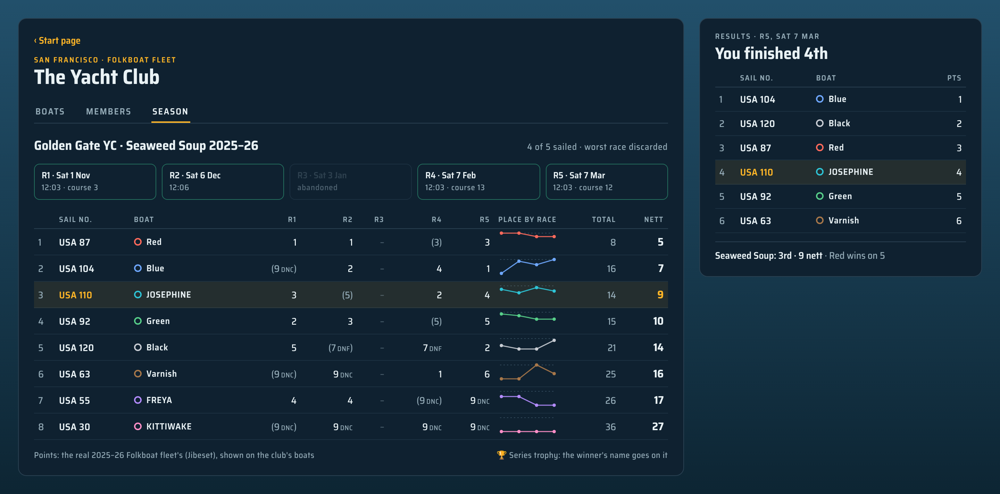

# A racing season (approved by the owner 13 Nov 2026; built: src/club/season.ts, src/ui/season.ts)

A series of real races, sailed one by one on their real days, scored as a series, against the same club fleet each
time, for a trophy that stays in the club's history. It joins racing to the community element: you race *for the club's
series*, not just a race.

*The mock-up, redrawn after the owner's feedback (13 Nov). It's the Yacht Club's layout (Boats · Members · Season),
and every boat list shows country and sail number beside the name, since sailors in a fleet go by sail numbers. Boat
chips each get a colour of their own in a series: a boat's hull colour where it's distinct, otherwise one from a fixed
palette (FREYA violet, KITTIWAKE pink, yours teal). Your boat's row highlight (amber) stays apart from the palette.
Each row has a place-by-race sparkline, 1st at the top. The points are real: the
2025–26 Seaweed Soup Folkboat fleet's published race points (Jibeset, saved in
src/boat/data/sf-folkboat-results.json), scored as a series, and shown on the sim's fleet. Polperro's are on Red,
Faith's on Blue, Josephine's on yours (JOSEPHINE, USA 110), Circle Sea's on Green, Thea's on Black, Shanty's on Varnish,
Cicciolina's on FREYA and Rødhætte's on KITTIWAKE. FREYA and KITTIWAKE are the sim's first two generic club boats.*

## Which series

**GGYC's Manuel Fagundes Seaweed Soup, 2025–26.** It's the one series the sim already holds whole:
- five race days, the first Saturday of each winter month (1 Nov, 6 Dec, 3 Jan, 7 Feb, 7 Mar), with each start;
- the course numbers (races 1, 3 and 4 are unverified against the 2025–26 sheet);
- every boat's points. Race 3 (3 Jan) was abandoned.

Source: https://www.jibeset.net/show.php?RR=GGYC_T008047221&DOC=fh&TYP=html, fetched 11 Nov 2026.

Each day already sails in its observed conditions in Run a past race. 2026–27 is under way, and only race 1 (7 Nov)
is saved so far. Its later days get added as they're sailed and published. No dates are invented.

The Folkboat fleet's own **Season Championship** (10 regattas in 2026, https://sfbayfolkboats.org/racing/) is the bigger
prize. Its rules, which regattas count and its discards, aren't published there, so it waits for a source or for the
owner.

## Scoring (RRS 2025–2028 Appendix A, low point)

- Race points as the sim scores them now (src/rules/scoring.ts).
- A5.2: a race not sailed is DNC, scored entries + 1 (9 for 8 entries). The real series did exactly this.
- **Series score, A2.1:** the total less the worst race, one discard by default. The Seaweed Soup's own discard rule isn't
  found, and the discard decides the series: with no discard, Faith drops from 2nd to 4th.
- **Ties, A8.1 then A8.2:** most firsts, then seconds, and so on; then the last race.
- To check: the A-rule wording here is from secondary sources. racingrulesofsailing.org and the World Sailing PDF are
  blocked from this session.

**Two facts from the real results the owner should know:**
1. The real series scored Folkboats on **handicap**, time on time with PHRF ("650/(550+PHRF)"), not as a one-design
   fleet. The sim scores boat for boat. With equal ratings the order is the same. The fleet's real ratings aren't known
   here.
2. A DNF there scored **starters + 1** (7, with 6 starters), not entries + 1 (9). That's an SI change to A5.2, as A5.3
   allows, so the sim would follow it. The Seaweed Soup SIs themselves weren't reachable (ggyc.com is blocked). The only
   SIs found are 2011's (https://luiz.yachtscoring.com/event_documents/566/41stmfsssi.pdf), too old to rely on.

## The fleet

You, plus 7 of the club's AI boats: 8 entries, as in the real fleet. They're the same 7 boats and skippers all season,
each with Skipper Model's ratings (start, speed, strategy, tactics, rules, consistency, nerve). Real boats' and sailors'
names stay out without permission. The standings are what happened in *your* races, so the AI boats' points come from
racing you.

## Where it lives (no new on-screen buttons)

- **The Yacht Club** gets a third tab, **Season**, beside Boats and Members. It replaces the "Club · Seasons: later"
  note. Its sections:
  - the calendar: five day tiles, each opening that race, the same as Run a past race's rows;
  - the standings: # · sail number · boat · race scores (discards in brackets) · place by race · total · nett;
  - the trophy, with its past winners.
- **The race results dialog:** its table gains the sail-number column, and one line goes under it: "Seaweed Soup: 3rd ·
  9 nett · Red wins on 5"
- **Run a past race:** the series' races are already there. Sailing one of them counts for the season. Saved, it goes in
  the logbook as now.

## The trophy, as a club tradition (docs/TRADITIONS.md, items 1 and 8)

The series winner's name and boat go on the club's trophy page, year after year. That is how the fleet's Hall of Fame
has named a season champion every season since 1958–59 (https://sfbayfolkboats.org/hall-of-fame/). Per the roadmap,
winning becomes an attribute of the boat and her skipper.

The Seaweed Soup's own perpetual is unclear. A 2013 report says it was retiring to its home club after 42 years
(https://norcalsailing.com/entries/2013/03/04/ggyc.html), but a 2016 article still names a "Manuel Fagundes Seaweed
Soup Perpetual Trophy" winner (https://issuu.com/bbcdirectories/docs/l38201604/s/13042573). Both were seen in search
summaries only. Until it's settled, the sim's trophy is simply "the series trophy".

## For the owner

1. Start with the Seaweed Soup 2025–26, or wait for the Folkboat Season Championship's rules?
2. Does the fleet race the Seaweed Soup on PHRF ratings, and are the ratings equal? Is there a known discard rule?
3. Roughly 6–10 h to build (the roadmap's estimate for seasons and awards), after Skipper Model's club fleet exists.

## The owner's answers, and what was built (13 Nov 2026)

1. **Start with the Seaweed Soup:** built. Yacht Club → Season. Each race day opens its race on its real day, start and
   course, in the day's observed wind and tide (Fort Point), against the club's fleet: the five club boats and the club's
   first two other Folkboats, 8 entries. Race 3 stays abandoned. Race 2's course wasn't recorded, so it's sailed on the
   race committee's choice for the day's wind. A race counts once you save it to her logbook; sailing it again and saving
   replaces it. The results show where the race puts you in the series.
2. **PHRF or level: level.** The real series scored Folkboats on PHRF time on time, but in every saved race (2025–26
   races 1, 2, 4, 5 and 2026–27 race 1) the published points follow elapsed time exactly, as equal ratings give. Time on
   time on equal ratings is boat for boat.
3. **Discards: one throwout, only once all five races are sailed.** Latitude 38, 25 Apr 2025, quoting Scott Easom: "all
   five races completed … which created the throwout"
   (https://latitude38.com/lectronic/golden-gate-yc-seaweed-soup-san-francisco). With race 3 abandoned, 2025–26 has no
   throwout. The series' own sailing instructions are still unread (ggyc.com and jibeset refuse this project's fetches).
   A DNF scores starters + 1, as the real series scored them (A5.3); a DNC entries + 1 (A5.2).
4. **Colours: hull colours, duplicates and all** (the owner: "that's true in life too"). Each sparkline ends in its sail
   number, and a row's line thickens on hover, so two lines of one colour can be told apart. A faint light edge keeps a
   black or navy hull visible on the dark panel.
