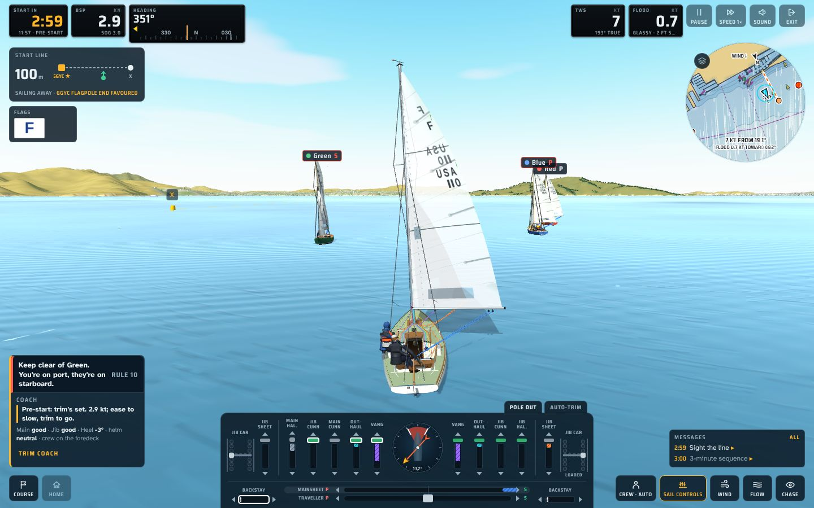
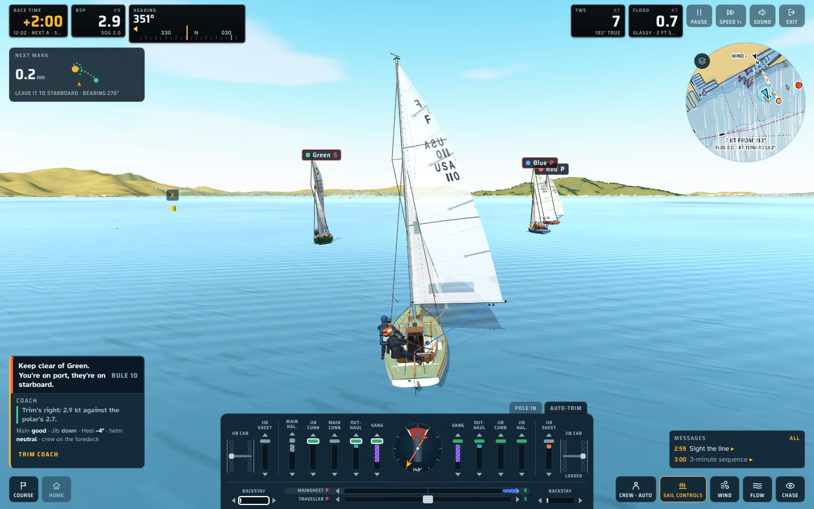
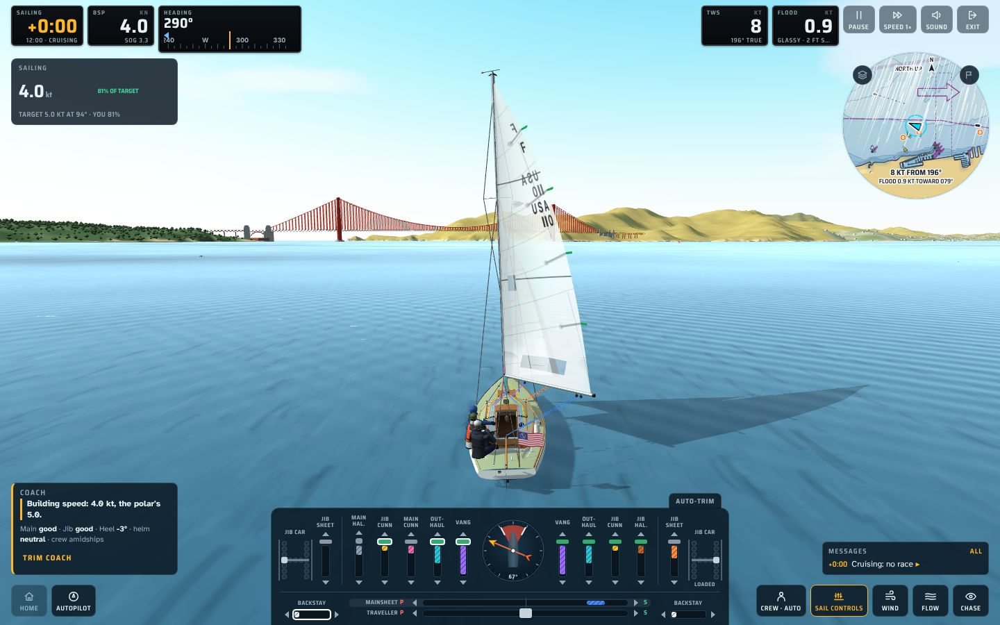

# The game surface: an audit (13 November 2026)

The owner's standing rule (CLAUDE.md): be extremely conservative about new buttons and distractions on the game surface,
and put new controls inside existing elements (the inset map, the sail band, menus, Keys). This audit lists everything on
screen in racing and cruising, says what each element does and how often a sailor needs it, and proposes what could
fold away. The aim is a calmer view of the boat and the water. This document is the proposal only; nothing changes until
the owner chooses.

The Wind and Flow buttons are left out: Crew Controls is already moving them into the inset map's Layers menu.

Captured from main at 5794ebb (v157+), 1440 × 900, chase view:

| Racing, pre-start | Racing, after the start | Cruising |
|---|---|---|
|  |  |  |

## What's on screen

How often a sailor needs each element:
- **Always**: glanced at every few seconds.
- **Often**: every minute or so.
- **Sometimes**: a few times a sail.
- **Rarely**: once a sail, or never.

### Top left: the instruments

| Element | What it does | Mode | Need |
|---|---|---|---|
| Clock pod (Start in / Race time / Sailing) | The start countdown or race time, with the time of day and the next mark's side under it | both | Always (racing); rarely (cruising) |
| BSP pod | Boat speed through the water, with SOG under it | both | Always |
| Heading pod | Heading over a ±50° tape, with the wind, the next mark and the other tack marked | both | Always (racing); often (cruising) |
| Where-next card | Start line, then over early, next mark, finish (racing); "Sailing · 4.0 kt · 81% of target" (cruising) | both | Often |
| Flags tile | The flags flying; click it for the flag index | racing, while flags fly | Sometimes |

### Top right: wind, water and the app

| Element | What it does | Mode | Need |
|---|---|---|---|
| TWS pod | True wind speed, with its direction under it | both | Often |
| Tide pod | Flood or ebb and its speed, with the sea state under it | both | Sometimes |
| Pause | Pauses the game; the pause menu has Restart, Setup, Settings and Exit | both | Rarely (key P) |
| Speed 1× | Time acceleration | both | Sometimes (cruising); rarely (racing) |
| Sound | Sound on or off | both | Rarely |
| Exit | Leaves the sail | both | Rarely (it's also in the pause menu) |
| Inset chart (round) | The map; click it for the full chart. Layers icon on its rim; in cruising, a Navigator icon on its rim | both | Often |
| "Tap map · chart" hint | Text hint under the chart | both | Rarely |

### Bottom left: the helm and the coach

| Element | What it does | Mode | Need |
|---|---|---|---|
| Situation strip | Right of way now ("Keep clear of Green… Rule 10"); only when there's a situation | racing | Often, when it shows |
| Coach card | The coach's one line, then "Main good · Jib down · Heel −4° · helm neutral · crew on the foredeck", and a Trim coach link | both | Often |
| Course | The course and the strategist | racing | Sometimes |
| Home | Send her home | cruising (also shown while racing) | Rarely |
| Autopilot (its panel when on) | The tiller pilot | cruising | Sometimes |
| Push off, Hoist jib, Hoist main, Motor | Leaving the dock, the sails up, the outboard | at the dock / with a motor | Once a sail |

### Bottom middle: the sail controls band

| Element | What it does | Mode | Need |
|---|---|---|---|
| The band (every line, the cars, the thwart, the round windex) | Trim | both | Always (the windex); often (the lines) |
| Tabs on its top edge: Hail, Penalty (left); Pole out/in, Auto-trim (right) | Hail and Penalty only when they apply; Pole only on a run | both | Sometimes; Hail urgent when it shows |

### Bottom right

| Element | What it does | Mode | Need |
|---|---|---|---|
| Messages card | The latest two messages, one line each; ALL opens the log | both | Often (a glance) |
| Crew · auto | Where the crew sit (a pop-up) | both | Sometimes |
| Sail controls | Shows or puts away the band (key 4) | both | Rarely |
| View (Chase / Cockpit / Overhead) | Changes the camera (keys 1, 2, 3) | both | Sometimes |
| Ahead (only after you've looked around) | Looks ahead again | both | Sometimes |

### In the water (labels)

Boat names with their tack ("Green S"), marks ("X"), the committee flagpole. Racing: always needed.

## Counted

- **Racing, after the start:** 18 controls and dials on screen, plus the band: 5 pods, 2 cards, the chart, 4 app buttons,
  2 bottom-left buttons, 5 bottom-right buttons.
- **Cruising:** 17.
- **Of those, the sailor needs only 6 often or always:** the 3 pods, the chart, the coach card and the band.

## Proposals (most calming first)

Each proposal folds a button into something already on screen. None adds a new element.

1. **Four app buttons become one.** Keep **Pause** (it opens the pause menu). Put **Sound** and **Exit** in that menu;
   Exit is already there. Speed moves into Pause's menu too, and gets a rebindable key. Nearly every letter and digit is taken, so the key
   is for the owner to pick. *Saves 3 buttons top right.* In cruising, where speed is used more, the menu shows the
   current speed (1×, 4×), so the one button still tells you.
2. **Sail controls goes; the band puts itself away.** A small ▾ at the band's top edge, beside Auto-trim, puts it away.
   With the band away, clicking the windex (which stays on screen) brings it back. Key 4 is unchanged. *Saves 1 button.*
3. **Crew goes into the Coach card.** The card's grey line already says where the crew are ("crew on the foredeck").
   Clicking that line opens the same crew pop-up, and its "auto" or "you" reads in the line. *Saves 1 button.*
4. **Course goes into the where-next card.** That card is about the course already (the start line, the next mark).
   Clicking it opens the course and the strategist (key M is unchanged). In cruising, the Navigator is already on the
   chart's rim. *Saves 1 button.*
5. **Home only when cruising.** Today it's shown, dimmed, while racing. Hide it while racing; a retired boat sailing home
   gets it back. *Saves 1 button while racing.*
6. **The cruising where-next card earns its place or goes.** "Sailing · 4.0 kt" repeats the BSP pod.
   - With a destination: show the navigator's next waypoint, as designed (design/chase-layout.html, "Cruising").
   - With none: hide the card, or fold its useful part ("81% of target") into the BSP pod's small line.
   *Saves a card when there's no passage.*
7. **The chart's caption goes.** "Tap map · chart" becomes hover text only, as agreed for the chase layout.
8. **Messages rest when quiet.** After a minute with nothing new, the card shrinks to its header line ("Messages · ALL").
   A new message brings it back for a while. *Calmer during long legs and cruising.*
9. **The Tide pod's second line, cruising only (optional).** "Glassy · 2 ft swell" is also on the chart's layers. Keep it;
   it's small. Listed for completeness, not recommended.

**Left as they are:**
- the three pods;
- the chart;
- the band and its tabs;
- the View button (the camera changes often enough to keep it, and keys 1–3 work);
- the situation strip and Hail, which are urgent and only shown when they apply;
- the flags tile, which is gone after the start.

**After 1–8**, racing shows the pods, the where-next card, the chart, Pause, the coach card, the band, Messages and View:
**11 elements instead of 18**, with no lost function. Everything removed is one click away inside something already on
screen, and every key stays.

## Questions for the owner

1. Is Speed fine inside the pause menu plus keys, or do you use it often enough in cruising to keep its button?
2. For the band: a ▾ on its edge to put it away, and the windex to bring it back. Does that suit you, or would you rather
   keep a button?
3. Cruising card with no destination: hide it, or keep "% of target"?
4. Messages shrinking when quiet: yes or no?
